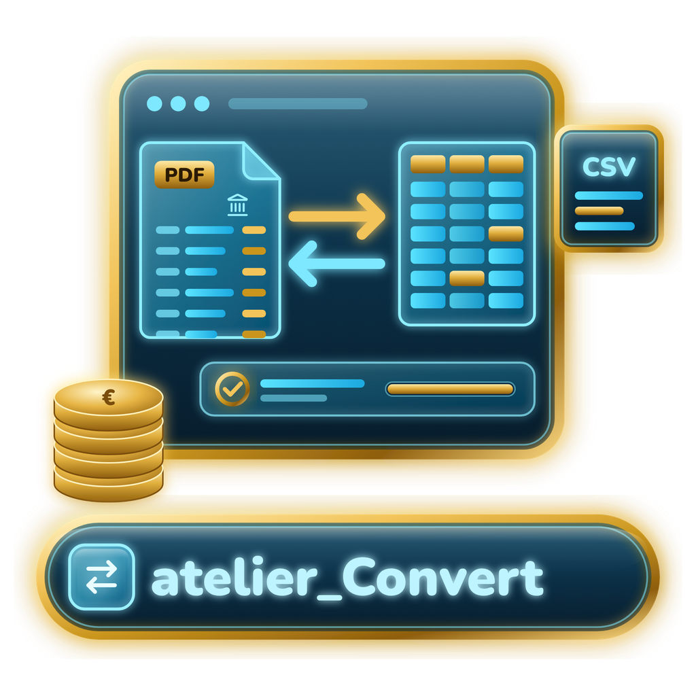

# Atelier Convert



Application **locale** de la Suite Atelier qui transforme vos fichiers en **tables propres pour Atelier Tab** :
un relevé bancaire en PDF devient Date · Libellé · Débit · Crédit · Montant (· Solde), un export CSV ou TXT de
banque est nettoyé et typé, un classeur Excel, un fichier OFX / QIF ou un JSON devient une table — et un relevé
**scanné ou photographié** est lu par **OCR** (Tesseract, sur la machine).
Ensuite : **export** (CSV français, CSV standard, TXT, XLSX, JSON `atelier-table/1`) ou **« Envoyer dans Atelier Tab »**,
qui crée directement la table dans le projet choisi.

- **Hors ligne par défaut** : la lecture des fichiers, les exports et l'envoi vers Tab se font sur la machine.
- **IA facultative** (« Structurer avec l'IA ») pour un document que la lecture automatique ne sait pas mettre en
  table : Ollama en local, ou Claude (CLI Claude Code, isolée et sans outils) en mode « En ligne ».
- Même design que la suite : charte « néon monochrome », couleur signature **or bronze `#C9951D`**,
  icône `arrow-right-left`, sélecteur « Suite Atelier », clair / sombre / système.
- Conventions pour Claude : [`CLAUDE.md`](CLAUDE.md) · contrat commun de la suite : [`docs/SUITE.md`](docs/SUITE.md) (§4.4).

## Démarrage

```bash
# 1. Backend
cd backend
python3 -m venv .venv && source .venv/bin/activate      # Windows : .venv\Scripts\activate
pip install -r requirements-dev.txt
cp .env.example .env
uvicorn main:app --reload --port 8010                   # http://127.0.0.1:8010/docs

# 2. Frontend
cd frontend
npm install
npm run dev                                             # http://127.0.0.1:5176

# 3. Optionnel — IA
ollama serve && ollama pull llama3.2                    # IA locale
claude auth login                                       # Claude (mode « En ligne »), avec votre compte claude.ai

# 4. Optionnel — OCR des relevés scannés et des photos
brew install tesseract tesseract-lang                   # macOS
winget install UB-Mannheim.TesseractOCR                 # Windows (cocher « French » dans l'installateur)
sudo apt install tesseract-ocr tesseract-ocr-fra        # Linux
```

Premier essai : **Convertir → Essayer avec un exemple** (`samples/` : un relevé PDF fictif sur deux pages, un export
CSV Windows-1252 avec préambule, un fichier OFX, et le même relevé scanné pour l'OCR).

## Ce que sait lire Atelier Convert

| Fichier | Lecture |
|---|---|
| **PDF de relevé bancaire** | Mots et positions (pdfplumber) : en-tête Date / Libellé / Débit / Crédit / Montant / Solde reconnu, sinon positions des montants ; libellés sur plusieurs lignes ; « 1 234,56 » recollé ; dates sans année complétées par la période du relevé ; « À reporter », « Total » ignorés ; soldes initial et final lus et **contrôlés** (solde initial + crédits − débits = solde final). |
| PDF avec tableaux | Tableaux détectés page par page, réunis (en-têtes répétés retirés). |
| PDF de texte | Une ligne par ligne, prête pour « Structurer avec l'IA ». |
| **PDF scanné, photo** (JPG, PNG, TIFF, WebP, BMP) | **OCR** par Tesseract, sur la machine : pages rendues à 300 ppp, mots et positions reconnus puis lus exactement comme un PDF texte (relevé, contrôle des soldes). Automatique pour un PDF sans texte ; « Toujours » / « Jamais » dans les options. Chiffres mal lus corrigés (« 1O,5O » → « 10,50 ») ; une opération au montant illisible est gardée et signalée. Confiance moyenne affichée. |
| **CSV / TXT** | Encodage (UTF-8, Windows-1252…), séparateur (`;` `,` tabulation `|`), préambule ignoré, en-tête détecté ; texte aligné par des espaces découpé en colonnes. |
| **XLSX / XLS** | Feuille au choix, préambule et en-tête comme un CSV, dates Excel gardées. |
| **OFX / QFX, QIF** | Opérations, références, catégories, solde final (OFX). |
| JSON | Liste d'objets (aplatie sur un niveau) ou table `atelier-table/1`. |

Dans tous les cas : types déduits (date, montant, nombre, oui / non, texte), nombres au format français ou anglais,
et, quand les colonnes ressemblent à un relevé, **mise en forme normalisée** (quelle que soit la banque) — à
désactiver par « Telle quelle ». Dans l'aperçu : renommer, écarter, retyper, réordonner les colonnes ; une valeur qui
ne se convertit pas est surlignée et gardée telle quelle. Tout reste modifiable : « Relire le fichier » avec d'autres
options (pages, année, séparateur, encodage, en-tête, lignes à ignorer, virgule décimale, ordre des dates).

## OCR (relevés scannés et photos)

Tesseract est lancé **sur la machine**, sans réseau ni fichier temporaire (image sur l'entrée standard). Langues :
français + anglais par défaut ; sans le français, l'OCR marche mais lit moins bien les accents (Réglages le signale).
Réglages : `CONVERT_OCR_TESSERACT` (chemin de l'exécutable si l'app ne le trouve pas — elle cherche le PATH, Homebrew,
`/usr/local/bin`, `Program Files\Tesseract-OCR`), `CONVERT_OCR_LANGUAGES`, `CONVERT_OCR_TESSDATA`, `CONVERT_OCR_DPI`
(300), `CONVERT_OCR_MAX_PAGES` (50), `CONVERT_OCR_ENABLED`. Un scan droit à 300 ppp donne les meilleurs résultats ;
**vérifiez toujours** les montants : le contrôle des soldes signale une opération mal lue.

## Envoyer dans Atelier Tab

Choisissez le projet (lu dans `~/Atelier_Tab/atelier.json`) et le nom de la table : Convert écrit **un seul
fichier**, `~/Atelier_Tab/tables/<id>.json`, au format de Tab. Tab le rattache au projet et, s'il est ouvert,
l'affiche aussitôt. Colonnes typées (dates, montants en €), libellé en titre des lignes. Aucun autre fichier de Tab
n'est modifié, aucun réseau. Autre dossier : `ATELIER_TAB_DATA_DIR` dans `backend/.env`.

## Application de bureau (macOS, Windows)

Comme Atelier Viz : l'application installée est un **lanceur du dépôt** qui se met à jour toute seule après un
`git pull` (docs/SUITE.md §8) ; fenêtre native (pywebview), serveur sur `127.0.0.1:8010` (autre port libre si pris).

```bash
# macOS — une fois, dans l'environnement Python du backend
source backend/.venv/bin/activate
pip install -r backend/requirements-desktop.txt
./scripts/macos/build_app.sh            # → ~/Applications/Atelier Convert.app
```

```powershell
# Windows 10/11 — sans droits d'administrateur (Git, Node.js 22.12+, Python 3.11+ requis)
powershell -ExecutionPolicy Bypass -File scripts\windows\install.ps1
```

Journaux : `~/Library/Logs/Atelier Convert/` (macOS), `%LOCALAPPDATA%\Atelier Convert\Logs\` (Windows).
Sans fenêtre native : `python desktop.py --browser` (dans `backend/`).

## Nœud Atelier (workflows Nexus)

`GET /api/atelier/manifest` (`atelier-node/1`) : `conversions.list`, `conversions.table` (`atelier-table/1`),
`conversions.convert_file` (fichier en base64), `tab.projects`, `conversions.send_to_tab`, `conversions.delete` ;
événements `convert.conversion.created | updated | sent_to_tab | deleted` sur `GET /api/atelier/events`.
Écritures idempotentes par `Idempotency-Key`. Tout reste en bouclage (`127.0.0.1`).

## Vérifier

```bash
cd backend && pytest && ruff check .                    # moteur, routes, nœud Atelier, lanceur de bureau
cd frontend && npm test && npm run build
```

## Arborescence

```
backend/
  main.py                       create_app() ; erreurs ; interface compilée servie sur /
  app/services/convert/         values (nombres, dates, types), text, pdf, ocr (Tesseract), statement (relevés), bankfiles (OFX, QIF),
                                table, pipeline, writers (CSV, TXT, XLSX, atelier-table), tab (écriture vers Tab),
                                store (historique), service, ai_structure
  app/services/ai/              Ollama, CLI Claude (isolée), API Anthropic, routage hors ligne / en ligne
  app/services/atelier/         manifeste, journal d'événements, idempotence
  app/desktop.py, launcher.py   application de bureau et mise à jour automatique
frontend/src/
  features/convert/             accueil, dépôt, atelier (aperçu, synthèse du relevé, lecture, exports, Tab, IA)
  features/history, settings    historique, réglages
  components/layout             marque, barre latérale, en-tête, sélecteur de la suite
  styles/atelier-ds, atelier-brand   copies verbatim du design system et de la marque
samples/                        exemples fictifs (scripts/samples/make_samples.py)
scripts/brand/make_logo.py      logo et icônes
```
